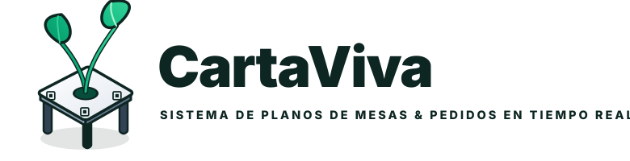

<p align="center">
  
</p>

# 🌿 CartaViva — Sistema de Planos de Mesas & Pedidos en Tiempo Real

Plataforma SaaS multi-restaurante para bares, cafeterías, terrazas y puestos de ferias donde el dueño dibuja el plano de sus mesas en 2D, genera los códigos QR automáticamente y sincroniza los pedidos en tiempo real con cocina y caja sin tocar código.

---

## 👥 Equipo (2º ASIR)

| Integrante | Rol | Responsabilidades |
|---|---|---|
| **Aarón Cruz** | Líder · DevOps & Vistas Operativas | VPS, Docker, Nginx HTTPS, Monitorización (Uptime Kuma/Dozzle), Cliente QR, Cocina KDS y Caja TPV |
| **Omar Monroy** | Backend & Base de Datos | PostgreSQL + Prisma, Redis, API REST (Node/Express), Seguridad JWT/Multi-Tenant y WebSockets (Socket.io) |
| **Aitor González** | Frontend Admin & Editor 2D | React + Vite + Tailwind, Editor de planos 2D (Konva.js), Consola SuperAdmin, Panel del Dueño y Web Comercial |

---

## 📁 Estructura del Repositorio y Reparto por Carpetas

Para **no pisarnos el trabajo ni generar conflictos en Git**, cada integrante tiene asignadas sus carpetas exclusivas:

```text
ProyectoCartaViva/
├── docker-compose.yml               # (Aarón) Orquestación de los 7 contenedores
├── .env.example                     # (Todos) Plantilla de variables (copiar a .env, NUNCA subir .env)
│
├── docs/
│   ├── schema.sql                   # (Omar) Esquema PostgreSQL v2.0 (11 tablas multi-tenant)
│   ├── API.md                       # (Omar) Contrato oficial de rutas REST y eventos Socket.io
│   └── branding/                    # (Todos) Logotipos oficiales SVG y 4K
│
├── infra/                           # 👉 ZONA EXCLUSIVA DE AARÓN (Sistemas/DevOps)
│   ├── nginx/nginx.conf             # Reverse proxy, rate-limiting y soporte WebSockets
│   └── scripts/backup-db.sh         # Copia de seguridad nocturna automática
│
├── backend/                         # 👉 ZONA EXCLUSIVA DE OMAR (Backend y BD)
│   ├── prisma/                      # schema.prisma y seed.js
│   └── src/
│       ├── middlewares/             # Auth JWT, Multi-Tenant, Anti-Trolls, Suscripción
│       ├── routes/                  # Endpoints REST
│       └── sockets/                 # Eventos Socket.io en tiempo real
│
└── frontend/                        # 👉 ZONA COMPARTIDA (Aitor + Aarón, separada por subcarpetas)
    └── src/
        ├── i18n/                    # (Aitor + Aarón) Diccionarios Español / Inglés
        ├── components/              # Componentes comunes y TicketTermico80mm (Aarón)
        └── pages/
            ├── admin/               # 👉 ZONA DE AITOR: Landing, SuperAdmin, Panel Dueño y Editor 2D Konva
            └── operativa/           # 👉 ZONA DE AARÓN: Carta Móvil QR, Cocina KDS y Caja TPV
```

---

## 🛠️ Método de Trabajo del Equipo (Cómo trabajar sin errores)

### 1. Reglas de Oro (Obligatorias)
* **Cada uno en su carpeta:** Omar solo edita dentro de `backend/` y `docs/API.md`. Aitor solo edita dentro de `frontend/src/pages/admin/`. Aarón edita `infra/`, `docker-compose.yml` y `frontend/src/pages/operativa/`.
* **Respetar `docs/API.md`:** Si Omar cambia o añade una ruta en la API, debe actualizar primero `docs/API.md` y avisar por el grupo para que Aitor y Aarón lo sepan.
* **Archivos compartidos (`package.json`, `App.jsx`):** Si alguien instala una librería nueva o añade una ruta en `App.jsx`, hace un commit pequeño rápido y avisa al resto para evitar conflictos.
* **Seguridad estricta:** **JAMÁS** subir archivos `.env`, contraseñas reales, claves SSH ni `node_modules/`. El `.gitignore` ya está configurado para protegerlos.

---

### 2. Flujo de Trabajo en Git (Ramas y Pull Requests)

**Nunca se hace `git push` directo a `main`.** Cada miembro trabaja en su propia rama y sube los cambios mediante **Pull Request** en GitHub:

1. **Antes de empezar a programar cada día, actualiza `main`:**
   ```bash
   git checkout main
   git pull origin main
   ```
2. **Cámbiate a tu rama de trabajo (o créala si es la primera vez) y tráete lo último de `main`:**
   * **Aarón:** `git checkout aaron_estructura` *(o `feat/aaron-operativa`)*
   * **Omar:** `git checkout backend` *(o `feat/omar-backend`)*
   * **Aitor:** `git checkout -b feat/aitor-frontend`
   ```bash
   git merge main
   ```
3. **Programa dentro de tu carpeta, guarda y haz commit con prefijos claros (`feat:`, `fix:`, `docs:`):**
   ```bash
   git add .
   git commit -m "feat: descripcion clara de lo que has hecho"
   git push -u origin <tu-rama>
   ```
4. **Abre el Pull Request en GitHub:** Entra al repositorio en GitHub, pulsa **"Compare & pull request"** hacia `main`, revisamos que no haya conflictos y le damos a **Merge**.

---

## 🚀 Arranque Rápido (Entorno VPS o Local con Docker)

1. Copia la plantilla de variables de entorno:
   ```bash
   cp .env.example .env
   ```
2. Edita `.env` con tus contraseñas locales o de producción.
3. Levanta toda la infraestructura:
   ```bash
   docker compose up -d --build
   ```
